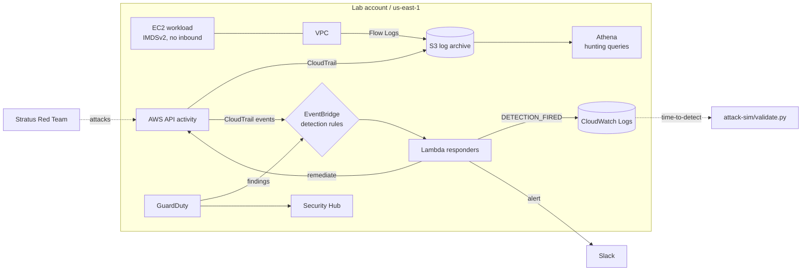

# aws-detection-lab

A Terraform-built AWS detection and response lab. I stand up a realistic environment as code, wire it with full security telemetry, run simulated attacks against it, and verify that every detection fires and every automated response works.

> **Status: Phases 1–6 complete. 8/9 simulated attacks detected and auto-remediated in 2–11 seconds; the 9th was blocked outright by a Phase 2 control.** This is a build-in-public project; each phase gets a writeup as it lands. Follow along below.

## Architecture



## Phases

| Phase | Focus | Status |
|-------|-------|--------|
| 1 | Account hardening: root lockdown, IAM baseline, billing guardrails, S3/EBS defaults | ✅ Done |
| 2 | Rebuild everything as Terraform — reproducible, destroyable | ✅ Done |
| 3 | Telemetry: CloudTrail, VPC Flow Logs, GuardDuty, Security Hub, Athena | ✅ Done |
| 4 | Detection engineering: EventBridge rules → Lambda auto-remediation | ✅ Done |
| 5 | Attack simulation: Stratus Red Team / CloudGoat, validate detections | ✅ Done |
| 6 | Writeups and packaging | ✅ Done |

## Detections

Each detection is one JSON file in [`detections/rules/`](detections/rules/). Design rationale and known gaps: [docs/design-notes.md](docs/design-notes.md).

| ID | Detection | ATT&CK technique | Telemetry source | Automated response |
|----|-----------|------------------|------------------|--------------------|
| DL-001 | Root account used | T1078.004 Valid Accounts: Cloud Accounts | CloudTrail → EventBridge | Slack alert |
| DL-002 | Security logging disabled or modified | T1562.008 Disable or Modify Cloud Logs | CloudTrail → EventBridge | Restart stopped trail, Slack alert |
| DL-003 | Security group opened to 0.0.0.0/0 or ::/0 | T1562.007 Disable or Modify Cloud Firewall | CloudTrail → EventBridge | Revoke the offending rules |
| DL-004 | IAM persistence (keys/password/admin for another user) | T1098.001 Additional Cloud Credentials | CloudTrail → EventBridge | Quarantine user: deny-all, keys off, password removed |
| DL-005 | S3 bucket policy grants public or external access | T1537 Transfer Data to Cloud Account | CloudTrail → EventBridge | Delete the bucket policy |
| DL-006 | GuardDuty finding, severity ≥ 4 | Varies (e.g. T1552.005 Cloud Instance Metadata API) | GuardDuty → EventBridge | Slack alert |

Hunting queries (saved in Athena): root activity, console logins without MFA, AccessDenied bursts by principal, logging tampering, IAM persistence, rejected inbound flows, top outbound talkers. See [`detections/queries/`](detections/queries/).

## Attack validation

Run with [Stratus Red Team](https://stratus-red-team.cloud/) via [`attack-sim/validate.py`](attack-sim/validate.py), which detonates each technique, waits for the matching `DETECTION_FIRED` record, and measures time-to-detect (detonation start → responder log line). Raw results: [`attack-sim/results/`](attack-sim/results/).

| Technique | Detection | Result | Time to detect | Automated response |
|-----------|-----------|--------|----------------|--------------------|
| `aws.defense-evasion.cloudtrail-stop` | DL-002 | ✅ | 4s | Trail restarted |
| `aws.defense-evasion.cloudtrail-delete` | DL-002 | ✅ | 2s | Alert |
| `aws.defense-evasion.vpc-remove-flow-logs` | DL-002 | ✅ | 2s | Alert |
| `aws.exfiltration.ec2-security-group-open-port-22-ingress` | DL-003 | ✅ | 9s | Rule revoked |
| `aws.persistence.iam-create-admin-user` | DL-004 | ✅ | 6s | User quarantined |
| `aws.persistence.iam-create-user-login-profile` | DL-004 | ✅ | 3s | User quarantined |
| `aws.persistence.iam-backdoor-user` | DL-004 | ✅ | 3s | User quarantined |
| `aws.exfiltration.s3-backdoor-bucket-policy` | DL-005 | ✅ | 11s | Bucket policy deleted |
| `aws.credential-access.ec2-steal-instance-credentials` | DL-006 | ⛔ Blocked | — | IMDSv2-required default (Phase 2) stopped the theft before any detection was needed |

What missed, what broke, and what I changed: [Phases 2–6 writeup](writeups/phases-2-6-build-detect-attack.md#phase-5-attacking-it).

## Repo layout

```
terraform/
  modules/          # baseline, workload, logging, detection
  envs/account/     # Permanent account baseline (apply once)
  envs/lab/         # The lab: destroy between sessions
detections/
  rules/            # One JSON per detection: metadata + EventBridge pattern
  queries/          # Athena hunting queries
  fixtures/         # Sample events used by the tests
lambdas/            # Python responders + unit tests
attack-sim/         # Phase 5 attack validation harness and results
docs/               # Deploy runbook and design notes
writeups/           # Phase writeups and attack narratives
```

## Running it yourself

```bash
# Prereqs: AWS account, Terraform >= 1.7, AWS CLI configured, Python 3.12+
make test                # offline unit tests
make account             # permanent baseline (once)
make set-slack-webhook   # store the Slack webhook in SSM (once)
make lab-apply           # deploy the lab
make smoke-test          # GuardDuty sample finding -> Slack
make attack ACCOUNT_ID=123456789012   # Phase 5 validation

# Tear down when done: this lab is designed to be destroyed between sessions
make lab-destroy
```

Full runbook: [docs/deploy.md](docs/deploy.md).

**Cost notes:** single region, single AZ, Athena instead of always-on OpenSearch, `terraform destroy` between sessions. Designed to run on a small credit budget without surprises.

## Security hygiene in this repo

- No Terraform state committed (`.gitignore` covers `*.tfstate*` — state files contain secrets)
- `gitleaks` runs pre-commit (`pre-commit install`); account IDs sanitized in all screenshots and logs
- Slack webhook lives only in SSM Parameter Store, never in code or Terraform state
- Attacks are run **only** against this environment, which I own

## Writeups

<!-- TODO: link each writeup as published -->
- [Phase 1: Locking down a fresh AWS account](writeups/phase-one-locking-down-a-fresh-aws-account.md)
- [Phases 2–6: Build it as code, wire the alarms, then attack it](writeups/phases-2-6-build-detect-attack.md)
